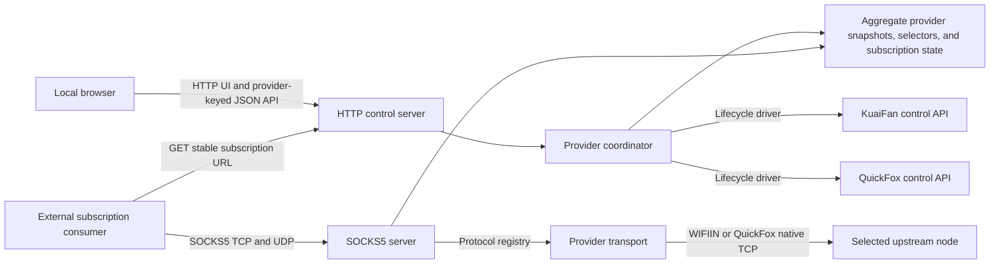
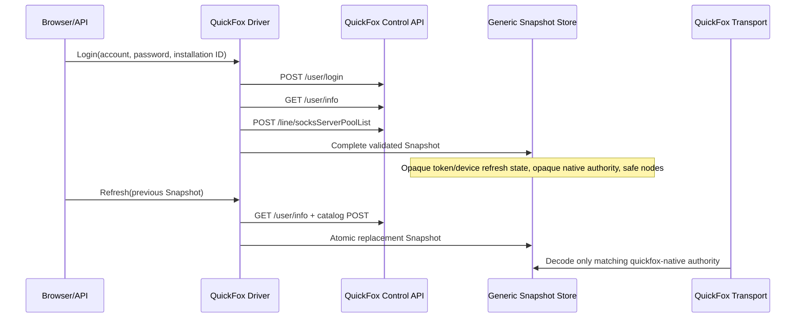

# chinadapter design

**Audience:** Implementers, security reviewers, and operators  
**Scope:** A provider-extensible containerized local SOCKS5 adapter, browser control plane, and stable installation-bound subscription service; the registered providers are KuaiFan and QuickFox.

## 1. Decision summary

| Area | Decision |
|---|---|
| Adapter interface | Expose one authenticated SOCKS5 listener, plus optional Snell v6 (unshaped), Shadowsocks 2022 and SOCKS5-TLS listeners that the console enables. Each logical node has its own credential on every protocol: a `socks5://` username, a Snell PSK, a Shadowsocks 2022 user key. |
| Subscription interface | Render a Base64-encoded, newline-delimited list of SOCKS5 URIs at one installation-bound UUIDv8 path; query options select `ss://` URIs or plain Surge policy lines for any enabled protocol. External consumers fetch that path on their own schedule. |
| Control plane | Serve the local UI and JSON API from the Go daemon. A local access token protects the browser session; provider login credentials remain transient, while validated provider session authority is retained in protected SQLite until explicit provider logout. |
| Data plane | Dispatch KuaiFan iOS-profile nodes through the observed Fanster-branded `WIFIIN` TCP and UDP-over-TCP framing and Windows-profile nodes through `SPEEDIN` (Shadowsocks AEAD with provider authentication, native UDP); QuickFox nodes through its observed native XOR-framed TCP proxy and TCP-carried datagram relay; Transocks nodes through on-demand Shadowsocks or Trojan; Baidu Proxy nodes through HTTP CONNECT (TCP only). |
| Smart route | One extra SOCKS username selects, per connection, the route that best reached domestic HTTPS sites in the latest scheduled probe round. |
| Deployment | Run production and the developer Compose with the host network so OpenWrt LAN addresses and ephemeral UDP association ports are directly reachable. Production pins the image by digest; preflight, upgrade, backup, restore and legacy-migration scripts operate on the Compose-managed volume. |



The external consumer remains outside the adapter trust boundary. It fetches the published artifact; its configuration, routing policy, and update schedule are its operator's responsibility.

## 2. Goals and boundaries

### Goals

1. Authenticate to the observed control API without weakening TLS validation or collecting device identifiers.
2. Maintain complete, immutable session and node snapshots; retain valid runtime data across temporary control-plane outages and daemon recreation.
3. Provide a local, browser-authenticated management UI and API whose unexpired opaque sessions survive daemon recreation.
4. Provide selector-authenticated SOCKS5 `CONNECT` and `UDP ASSOCIATE` for eligible nodes.
5. Publish one subscription URL whose credentials survive provider login/logout, account swaps, catalog changes, and restarts; only an access-token change rotates them.
6. Preserve confidentiality of account, session, selector, proxy-authentication, and local access-token material.
7. Fail closed for unsupported SOCKS commands, fragmented UDP, and unverified UDP address forms.

### Non-goals

- Implementing a general VPN or routing engine, or inbound protocols beyond SOCKS5, SOCKS5-TLS, Snell v6 (unshaped) and Shadowsocks 2022 TCP.
- Promising compatibility with a consumer that does not accept Base64-encoded newline-delimited SOCKS5 URIs.
- Exposing the UI, SOCKS listener, or subscription endpoint to the LAN by default.
- Persisting raw local access tokens, provider login accounts or passwords, or relay state.
- Providing an unauthenticated local access-token reset facility.
- Claiming that the legacy tunnel provides modern authenticated encryption.
- Resolving SOCKS UDP domain destinations directly or claiming IPv6 UDP support; observed WIFIIN nodes accept only IPv4 UOT destination frames.

## 3. Trust and state model

The daemon maintains three related state domains:

- **Provider catalog** is an immutable aggregate of provider-keyed snapshots containing browser-safe account views, opaque refresh state, transport authorities, nodes, and expiry hints. Provider mutations preserve the other providers. Probe-only health updates remain process-local.
- **Browser access state** contains `sha256(cookieToken)` and expiry. Raw cookie tokens are never persisted; the unused legacy CSRF column remains only for schema compatibility. Login attempts and throttling reservations remain process-local.
- **Installation identity** derives subscription and SOCKS credentials from the installation ID and the local access-token verifier. Provider identities and display labels never participate. No separate binding keys, account-scoped selector keys, or rendered subscription body are stored.

Schema v12 contains exactly `schema_version`, `state_metadata`, `access_token_verifier`, `preferences`, `excluded_node_ids`, `active_session`, `active_session_providers`, `active_session_authorities`, `active_session_nodes`, `browser_sessions`, `smart_proxy_preferences`, and `inbound_preferences`. `InstallationID`, exclusions, the smart-route policy, the inbound protocol switches, provider account/refresh/authority/node rows, expiry hints, and the Argon2id verifier remain durable. The legacy `preferences.refresh_policy` column is kept for schema compatibility but ignored; `provider.refreshInterval` in `config.yaml` is authoritative. Live username maps are rebuilt from the catalog and identity.

The store requires a non-symlinked, current-UID-owned `0700` directory and a regular, non-symlinked, current-UID-owned `0600` database with exactly one link. Initial creation and aggregate replacement are transactional. SQLite uses `_txlock=immediate`, foreign keys, a bounded busy timeout, secure deletion, rollback-journal `DELETE` mode, and `synchronous=FULL`. Every store operation accepts a context and uses context-aware SQL. Integrity checking runs only when opening a database; `Load` never prunes or writes state. The single aggregate write path validates its input and uses prepared statements for bulk inserts. `ErrStateBusy` distinguishes SQLite busy contention from corruption. Every physical connection sets `max_page_count` so `state.db` cannot grow past 18 MiB: an oversized write rolls back with `ErrStateFull` and the previous state stays intact. A closed store never silently reopens (`ErrStoreClosed`). A first run interrupted before its schema was committed leaves an incomplete file that the next start removes and recreates; any other unexpected file in the state directory is refused by name. Browser sessions whose expiry lies beyond the 24-hour maximum lifetime (a clock that stepped back) are pruned rather than treated as corruption. An injected clock controls browser-session lifecycle; eviction retains the latest expiry dates first (`expires_at_ns DESC`) and removes the oldest excess rows.

`AccessTokenVerifier` persists Argon2id salt, parameters, and a 32-byte derived hash. The supplied access token is trimmed, validated, used transiently for setup or login, and never written to state, logs, browser storage, or diagnostics. Provider login accounts and passwords are likewise transient. Each validated provider snapshot deliberately persists its canonical user ID, opaque refresh state, opaque tunnel authorities, redacted account summary, nodes, and `ExpiresAt` inside the protected database so daemon or container recreation does not force another provider login. `ExpiresAt` is only a staleness hint, not a deletion deadline or tunnel-admission condition. Each linked provider has its own refresh supervisor: the normal due time is the earlier of last success plus the refresh policy and `ExpiresAt` minus a 30-minute safety margin. Startup refreshes stale snapshots immediately without deleting them, and each one-minute tick rechecks the wall clock so suspension cannot skip work. Transient failures preserve the last-good snapshot and retry indefinitely with exponential backoff from one minute to a 30-minute maximum and ±20% jitter (clamped to that maximum). Explicit upstream `ErrSessionRejected` marks only that provider `needs_relogin`, retains its nodes and authority, and suspends automatic attempts until a manual refresh or login succeeds. If token rotation succeeds but the catalog fails, the coordinator durably merges only the returned `RefreshState` into the previous snapshot before returning the error.
Every failed refresh also records a closed failure class (`accounts.ErrorClass`: `network`, `session_rejected`, `login_rejected`, `device_limit`, `authority_expired`, `no_session`, or `unclassified`). The class, never the provider error text, is logged and returned per account as `refreshProblem` next to `refreshStatus`, `lastRefreshAt`, and `nextRefreshAt`, so the console can name the failing provider and its cause.

The externally visible service state is derived from the aggregate provider
statuses; it is not an independently edited transition graph:

| State | Entry condition | Exit | Runtime side effect |
|---|---|---|---|
| `signed_out` | No provider has a usable persisted session, or access authority is not initialized | A successful login begins `authenticating` | Clear active provider authority and reject new tunnel admissions |
| `authenticating` | A login operation is admitted and provider credentials are being verified | Login publishes a complete aggregate (`ready`), or fails back to `signed_out`/the previous usable state | Do not publish partial provider snapshots |
| `syncing` | A refresh or replacement login is rebuilding the aggregate | Complete publication yields `ready`; a failed refresh yields `degraded` when another usable aggregate remains | Existing complete snapshot remains pinned while network I/O runs |
| `ready` | Every required provider status is OK and a complete aggregate has eligible nodes | Provider refresh failure (`degraded`), logout (`signed_out`) | Admit new SOCKS flows and expose node details |
| `degraded` | At least one provider refresh fails while another usable aggregate remains | All providers recover (`ready`), logout (`signed_out`) | Keep the last complete aggregate; surface per-provider failure |
| `expired` | Not entered. Snapshots are never expired by time; the value is kept for API and frontend compatibility | Login begins (`authenticating`) or logout (`signed_out`) | None while unreachable |
| `error` | No usable aggregate remains after an operation or publication error | Login begins (`authenticating`) or logout (`signed_out`) | Keep process liveness but reject control/data operations that require a session |

`internal/credentials` calculates the installation key, domain-separated UUIDs, and SOCKS usernames; `internal/provider/route.go` owns the shared route identity, canonical node key, and node ID construction:

```text
instanceKey = HMAC-SHA256(AccessTokenVerifier.derivedHash,
                        "chinadapter/instance/v3\x00" || InstallationID)
subscriptionID = UUIDv8(HMAC-SHA256(instanceKey, "chinadapter/subscription/v3")[:16])
socksPassword = UUIDv8(HMAC-SHA256(instanceKey, "chinadapter/socks-password/v3")[:16])
nodeKey = provider || "\x00" || protocol || "\x00" || canonicalHost || "\x00" || decimalPort
nodeID = provider || "_" || base64url(SHA256(nodeKey)[:12])
socksUsername = "n_" || base64url(HMAC-SHA256(instanceKey,
                    "chinadapter/socks-user/v3\x00" || nodeKey)[:12])
smartUsername = "a_" || base64url(HMAC-SHA256(instanceKey, "chinadapter/smart-user/v1")[:12])
snellPSK = base64url(HMAC-SHA256(instanceKey, "chinadapter/snell-psk/v1\x00" || nodeKey)[:18])
smartSnellPSK = base64url(HMAC-SHA256(instanceKey, "chinadapter/snell-smart-psk/v1")[:18])
ssServerKey = HMAC-SHA256(instanceKey, "chinadapter/ss2022-server/v1")[:16]
ssUserKey = HMAC-SHA256(instanceKey, "chinadapter/ss2022-user/v1\x00" || nodeKey)[:16]
smartSSUserKey = HMAC-SHA256(instanceKey, "chinadapter/ss2022-smart-user/v1")[:16]
tlsKey = first valid P-256 scalar of HMAC-SHA256(instanceKey, "chinadapter/tls-key/v1\x00" || counter)
```

The SOCKS5-TLS certificate is self-signed for `chinadapter`, valid 2025–2099, and signed with RFC 6979 deterministic ECDSA, so its DER bytes and SHA-256 fingerprint are reproducible from the instance key: they survive restarts and change only with the access token, like every other credential.

UUID construction uses the first 16 digest bytes, sets the version nibble to 8 and the RFC 9562 variant bits to `10`, and formats a lowercase canonical 36-character UUID. There is no usable installation key before token setup, so subscription and SOCKS authentication are unavailable. All nodes share the instance password; a node's username depends only on its transport route. KuaiFan dials `NodeHost:NodePort`; QuickFox resolves `NodeHost` and dials `NodePort`. Transocks uses a stable synthetic line route and resolves its line ID from opaque authority to a provider-issued tunnel endpoint. Every transport dials only through the request's `Dial` function. Display labels are not routing inputs; authority identity is checked separately when pinning a tunnel.

Provider network I/O retains the existing per-provider lock; publication rebases concurrent provider and probe changes under a short mutation lock. Adding/removing a provider or changing its account never changes the installation identity. Removed nodes are omitted and cannot authenticate; when the same route returns its credentials work again. The subscription response path reads an atomically published catalog, renders a request-local authority, and never accesses SQLite or the mutation lock.

`internal/state` owns domain types, aggregate validation, and the runtime manager. `internal/store` imports `state` and owns SQLite persistence, browser-session lifecycle, and secure-file validation; `state` does not import `store`. The migration chain and historical definitions remain in `internal/store/migrate.go`, `migration_v9.go`, and `schema_history.go` because they share current schema definitions and store validation, durability, and codec helpers rather than exposing those internals through a separate migration package.

The rendered subscription body, derived selector credentials, provider session authority, and browser session tokens are secrets. They must not appear in logs, metrics, diagnostics, browser history, browser storage, or routine API responses. The authenticated node-details endpoint derives one current local SOCKS profile on demand; the browser clears it when the details popover closes and the service never returns provider tunnel secrets.

### Schema v9 release note

Upgrading from v8 changes the subscription URL and SOCKS credentials once. Copy the new `/sub/<36-char-uuid>` URL into each external consumer after upgrading. Subsequent provider account changes no longer rotate credentials. The v8-to-v9 migration keeps both providers' accounts, refresh state, authorities and nodes because every `nodeKey` input is already persisted; neither provider requires re-login or a forced catalog refresh. It recomputes route-based node IDs, merges duplicate routes, remaps known excluded IDs and drops exclusions with no matching node. Existing raw browser-session tokens are hashed so their cookies remain valid. It removes `subscription_authority`, `active_session_selectors`, `last_good`, `last_good_nodes`, and the stored node selector column. The committed `internal/store/testdata/v8.db` fixture was created by the v8 store at HEAD `a25303b` in a temporary worktree before store changes and exercises this preservation contract. Historical v4–v7 migrations retain their existing renewable-authority cutovers before reaching v9.

### Schema v12

Schema v12 (fork only) is v11 plus `inbound_preferences`, one row of three booleans for Snell, Shadowsocks 2022 and SOCKS5-TLS. Every migration path ends at v11 and then adds the row with all three disabled, so an upgrade never opens a listener by itself. A future upstream schema bump must be renumbered past 12.

### Schema v11 and the kfadapter lineage

This fork (formerly kfadapter) reused versions 9 and 10 for a different lineage: fork v9 is v8 plus `subscription_account_roster`, and fork v10 adds `smart_proxy_preferences`. Schema v11 is upstream v9 plus that byte-identical `smart_proxy_preferences` table, numbered past both lineages so neither can be mistaken for the current schema. `migrateSQLiteSchema` tells fork v9 from upstream v9 by exact schema definition.

- v8 migrates to upstream v9 and then to v11 with disabled smart-route defaults.
- Upstream v9 gains disabled smart-route defaults.
- Fork v9 and v10 take the upstream v8-to-v9 conversion in one transaction: the roster (whose only purpose was rotating credentials on an account switch) is dropped first, node IDs and exclusions are remapped, provider sessions are retained, the smart-route policy is kept (fork v9 gets the disabled default), and the fork's browser-session column, which already held `base64url(SHA-256(cookie))`, is decoded rather than hashed again.

Migrating a fork install therefore keeps the access token, provider sessions, exclusions and smart-route policy. The subscription URL and SOCKS credentials change once because the derivation scheme changed, and the renamed session cookie means each browser unlocks once more. The KuaiFan iOS device ID keeps its pre-rename `kfadapter-kuaifan-device` label so KuaiFan sees the same device. `internal/store/testdata/kfadapter-v10.db` was produced by the fork's store at `f6ded86` from the v8 fixture and exercises this contract.

### 3.1 Provider boundary

`internal/provider` defines provider-neutral lifecycle, snapshot, node, authority, registry, and transport contracts. A driver owns one provider's login and refresh protocol and returns a complete `provider.Snapshot`; refresh state and authority bytes remain opaque outside the originating driver and matching transport. The coordinator in `internal/accounts` serializes mutations, merges the changed provider snapshot with the other current providers, builds one collision-free selector map, and publishes the aggregate transactionally; the same package schedules independent provider refreshes. Provider IDs select lifecycle drivers; protocol IDs independently select SOCKS transports.

Each linked provider owns a `github.com/cenkalti/backoff/v5` exponential delay calculator for failed refreshes: a one-minute initial interval doubles to a 30-minute base cap with ±20% randomization, and the actual scheduled delay is also capped at 30 minutes. Failures never exhaust this schedule; a successful refresh or login resets it. The supervisor retains its injected clock for next-run times and keeps rejected accounts out of automatic retries until manual recovery.

`internal/accounts`, `internal/state`, `internal/store`, `internal/credentials`, `internal/subscription`, `internal/app`, `internal/web`, and `internal/socks` validate and route generic provider data only. They neither decode provider refresh state nor interpret authority bytes. A node references an authority in its own provider snapshot with the same protocol, and route-derived node IDs are globally unique. Schema v9 persists the normalized catalog but never derived usernames or rendered bodies.

`internal/app/wire.go` is the daemon composition root: `app.NewDaemon` constructs state, providers, accounts, SOCKS, web, and lifecycle workers, and `(*app.Daemon).Run(ctx)` supervises their lifetime. `cmd/chinadapter` owns only CLI dispatch, signal setup, the build-injected `main.version`, the health check, and configuration validation. `internal/web` has no concrete internal-service imports; its concrete subscription adapter lives in `internal/app/subscription_adapter.go`. Strict subscription-path parsing is injected through the web-owned `SubscriptionService` interface and delegates to `internal/credentials.ParseSubscriptionPath` without duplicating the parser.

Provider node IDs use the common `nodeKey` and SHA-256 construction above, prefixed by the provider ID. Hosts are canonical IP addresses or lowercase IDNA DNS names without a trailing dot. Protocols separate distinct transports at the same endpoint. Repeated routes collapse even when group, region, pool, or line labels differ; iOS remains preferred over Windows when KuaiFan profiles expose the same route.

The provider-neutral account contract is `{Tier, SubscriptionActive, SubscriptionEndsAt}`. `Tier` is a nonempty provider-defined display label. An active subscription requires an exact nonzero expiration; an inactive/free account has no expiration. Drivers normalize expired or incomplete paid metadata to their free tier unless the provider response claims currently paid access without the exact expiration required to authorize it, which is rejected. The status API and browser render the tier verbatim, show the expiration only while active, and never infer provider semantics from the label.

`Node.Eligible` is the provider driver's definitive subscription-and-transport admission result. Drivers may discard ineligible catalog rows before returning a snapshot; the coordinator also rejects them from the runtime aggregate. Runtime node APIs, node details, selector maps, and rendered subscriptions therefore contain only eligible nodes. The browser filters the flag again defensively and never presents an ineligible row returned by a stale or mismatched backend.

### 3.2 KuaiFan transaction boundary

All KuaiFan-specific control, fingerprint, encryption, refresh coordination, and tunnel-wire code lives under `internal/provider/kuaifan`. `internal/provider/kuaifan/profile` contains the standalone iOS and Windows wire-profile definitions and deterministic/randomized request builders. The application layer supplies only transient account credentials and a protected random installation ID; it does not choose a client profile, construct device fields, encrypt provider requests, parse provider responses, or decode WIFIIN authority.

The KuaiFan driver runs two immutable control clients: the captured iOS 4.18.4 profile and the recovered Windows 4.3.30 profile. Both reuse hardened HTTPS transport, bounded control codecs, line normalization, and catalog merge; their fingerprints, request schemas, refresh rules, authority parsing, and provider extensions remain separate. Both branches must return the same provider user ID. The account tier is `VIP` only when both profiles report VIP and the earlier of their exact expirations is still in the future; otherwise it is `Standard`, inactive, and has no displayed expiration. A transient failure in either branch leaves the prior complete provider snapshot current; no provisional session, authority, partial catalog, or mixed-generation node set is published. When exactly one profile's session is rejected, the driver publishes a complete snapshot from the surviving profile and keeps the rejected profile's state for a later retry; when both are rejected, refresh returns `provider.ErrSessionRejected`.

Session rejection is recognized only from observed responses. Authenticated KuaiFan endpoints (`user/refresh.do`, `invpn/getAuthority.do`, `invpn/getLines.do`) answer an unaccepted token with business status `-5`, observed live in 2026-10 for both profiles; every other non-success status stays transient. Logging in again from another device does not invalidate an existing token, and refresh returns the same token rather than rotating it.

KuaiFan request retries use `backoff.Retry` with the configured attempt bound (three by default, at most five), a 250ms default initial interval, doubling, and the library's ±50% randomization. Both the base interval and actual delay respect the configured maximum (five seconds by default). Only the existing transport/HTTP transient classifier permits another request; permanent errors and parent cancellation stop retries immediately, while a per-request timeout remains retryable if the parent is live.

Catalog merge gives iOS priority for routes present in both profiles and appends Windows-only routes. Historical evidence reported a 169-line labeled union (167 iOS lines plus two Windows-only lines); v9 route identities additionally collapse shared endpoints across display groups. Each source profile validates its own line protocol and marks only verified WIFIIN rows eligible. Each retained node references its source profile's opaque authority, and only `kuaifan-wifiin` decodes that authority. Localized tags compare case-insensitively with `_` and `-` equivalent. See [the protocol evidence report](kuaifan-ios-4.18.4-analysis.md) for request profiles, field-level evidence, historical inventory counts, and Fanster analysis limits.

### 3.3 QuickFox transaction boundary

All QuickFox-specific HTTPS, encrypted-envelope, catalog, membership, authority, and native-relay code lives under `internal/provider/quickfox`. Its stable IDs are provider `quickfox`, protocol `quickfox-native`, and authority `native`. The provider-neutral layers treat all QuickFox refresh and authority bytes as opaque.



The login and profile responses use the captured QuickFox AES-CBC envelope and bounded schemas. The original QuickFox 3.59.6 renderer is authoritative for entitlement: its `isVip()` returns SVIP when `userInfo.svip.svipTime > 0`, otherwise ordinary VIP when the quoted signed `userInfo.vipTime > 0`, and free access otherwise. Its native configuration maps free, VIP, and SVIP to values 0, 1, and 2. The adapter preserves those states as the provider-defined `Standard`, `VIP`, and `SVIP` tiers; `payVipFlag`, `userPayVipFlag`, exclusive flags, and `vipInfo[].grade` are not entitlement predicates.

An active VIP or SVIP countdown additionally requires a future exact `vipInfo[].endTime` for the matching period grade: grade 1 for VIP and grade 2 for SVIP. SVIP takes precedence if both countdowns are positive. The matching expiration becomes the browser-visible subscription expiration. Signed nonpositive VIP/SVIP countdowns represent inactive or expired access and are valid; the adapter normalizes them to `Standard` with no displayed expiration. A positive countdown without its matching future exact expiration is rejected as inconsistent provider state.

The catalog's embedded `userInfo` is accepted only as an identity cross-check because it can omit current profile data. The original renderer removes `feeType` 1, 2, and 3 from the free list and distinguishes the SVIP line class as `feeType = 3`. The adapter therefore admits visible, enabled `feeType = 0` lines for every tier, `feeType` 1 and 2 lines for VIP and SVIP, and `feeType = 3` lines only for SVIP. Unknown fee types and malformed catalog rows are rejected rather than guessed.

The persisted QuickFox `RefreshState` contains only the provider token, canonical user ID, and random installation device code needed to fetch a new complete snapshot. The opaque native authority contains the token, user ID, and app ID required by the matching transport. The driver sets a 24-hour staleness hint for scheduled refresh, not an authority-rejection deadline; browser subscription expiry is shown only for an active VIP or SVIP account. An authenticated request whose token is no longer accepted returns envelope code `401` with message `token失效，请重新登录` and no `success` field; the client maps it to `provider.ErrSessionRejected` (observed live in 2026-10). Other envelope codes stay transient. A second-device login does not invalidate an existing token, and the token is not bound to the device code it was issued with.

QuickFox catalog refresh uses the same bounded library retry policy for transient transport/HTTP errors: three attempts, a 250ms initial interval, doubling with ±50% randomization, and a 500ms ceiling on actual delays. Business/schema/crypto errors and confirmed token rejection are not retried within the request; the independent account supervisor retains state and handles later refresh scheduling. Parent cancellation stops the request retry immediately.

For a SOCKS `CONNECT`, the QuickFox transport resolves the requested destination to IPv4, opens separate control and data TCP connections to the selected relay, sends the recovered control and destination prefaces, waits for the 14-byte control acknowledgement (only its length is checked, since live relays vary its contents per connection), revalidates the immutable session pin, and then relays the stream through the recovered XOR framing.

QuickFox prefaces carry only an IPv4 destination, so the transport resolves domain targets on the adapter host and skips loopback, private, link-local, unspecified and RFC 6598 answers. The host's own resolver answers for the host's network, and the GSLBs of Chinese CDNs choose edges for that network. Measured in 2026-10 with ECS for the production VPS's /24 in Singapore, Bilibili video hosts (`upos-sz-mirror*.bilivideo.com`) returned mainland edges on another carrier than a Shanghai Telecom or Beijing Unicom client receives (for example China Mobile instead of China Telecom), and `i0.hdslb.com`, `s1.hdslb.com` and `api.bilibili.com` returned Singapore, US or Hong Kong edges, so traffic would leave China again after the relay. With `provider.quickfoxDoH` set (§4.1), lookups instead send that RFC 8484 resolver a recursive A query whose EDNS Client Subnet (RFC 7871) is the selected node's /24. AliDNS, DNSPod and Google Public DNS all honored a client-supplied subnet with scope 24 and returned the edges a client in that subnet receives. The node address is a QuickFox `connectIp`, so the subnet identifies the provider relay, not the user; it assumes the relay egresses from the network of its entry address.

Answers follow the CNAME chain from the queried name (at most 8 hops), pass the same address filter, and are cached per name and node /24 for the smallest TTL on the chain, clamped to 30 seconds–5 minutes, with at most 1024 entries. NXDOMAIN and answers without A records are final and cached for 30 seconds. One lookup may use half the handshake timeout, at most 3 seconds. A transport, TLS, HTTP or DNS-protocol failure (non-200 status, redirect, wrong media type, oversized, malformed or mismatched answer, `SERVFAIL` and other response codes) falls back to the system resolver and skips DoH for 30 seconds, so a resolver outage costs only edge selection. Caller cancellation and names that cannot be encoded fall back without starting that window, and a node host that is not IPv4 uses the system resolver. The DoH client verifies TLS against the system roots with TLS 1.2 or later, uses no proxy and follows no redirects. Like the system lookup it replaces, the query is name resolution on the adapter host: it carries no SOCKS payload and never substitutes for the relay, so it does not use `RelayRequest.Dial`. The resolver operator sees the queried names, as the system resolver's operator already does, plus the node subnet.

For a SOCKS `UDP ASSOCIATE`, the QuickFox transport uses the client's "udp2tcp" mode recovered from `QuickFoxCoreWin.dll` 3.60.14 and verified against live relays: one TCP connection authenticates with control command base `0x30` and, after the acknowledgement, carries datagrams in both directions. Each frame is a little-endian `uint32` length, a 14-byte header (random byte, big-endian association flow ID that replies echo, random byte, IPv4 address, big-endian port, little-endian sequence number wrapping after 60000, two zero bytes) and the raw payload, which is not XORed. Payloads above the native client's 2034-byte limit are discarded. Domain-targeted datagrams are resolved to IPv4 with the stream path's resolver and cached per association; IPv6 targets are discarded. The relay also accepts the same header over native UDP at the port in acknowledgement bytes 8–9, but live relays answered it on only some lines, so the adapter does not use it. QUIC is ordinary UDP to this relay.

### 3.4 Transocks on-demand lines

Transocks (`transocks-ss` and `transocks-trojan`) publishes physical catalog lines as `line-<id>.transocks.invalid:1`. Catalog `domain`, `iPAddr`, and `detectPort` are optional probe endpoints without a uniqueness/stability guarantee; neither those fields nor rotating connect endpoints determine the SOCKS username. Login discovers each eligible line's actual protocol once and discards the returned tunnel secrets. Refresh reuses the per-line protocol cache in opaque refresh state and makes no connect calls for known lines. New lines are provisionally SS and discovered lazily; a returned protocol mismatch fails the connection clearly, and the next Refresh applies the observed protocol. A genuine protocol change necessarily changes the protocol-derived route identity.

At most two authorities hold only token/type, installation metadata, and a stable node-key-to-line-ID table. Refresh state also holds the protocol cache, never the login password. Both transports share a two-entry in-memory LRU of current endpoints and SS/Trojan settings. Concurrent requests for one line coalesce into one connect call; connects for different lines are serialized. Eviction only forgets a config, because the observed server retains only the account's two most recently connected lines. A refused/reset cached endpoint gets one reconnect of the same line and one retry. Session rejection and membership/capacity errors propagate; there is no other-line or direct-target fallback. The server's limit is not a guarantee that more than two concurrent active lines will remain usable.

TCP reachability probes never open Transocks tunnels: both Transocks transports implement `provider.ProbeAddresser`, which returns the line's catalog detect endpoint (`iPAddr` or `domain` with `detectPort`, the endpoint the official client pings), so a whole-group probe cannot consume or churn the two connect slots. A line without a detect endpoint reports `probe_unavailable`. Transports without this capability are probed at their route address. Transocks login code `40003` ("out of devices") maps to `provider.ErrDeviceLimit` and the console's `device_limit` problem; login sends `autokick=0`, so it never signs the user out of another device.

### 3.5 Baidu cloud proxy (public)

The `baidu` provider declares no credential fields. Its nodes are the IPv4 addresses behind `cloudnproxy.baidu.com`, port 443, one node per address (sorted and de-duplicated, at most 64), protocol `baidu-http`. Each address runs an HTTP proxy for the Baidu app's zero-rated mobile traffic: the transport sends `CONNECT host:port` with Baidu's fixed proxy headers (`Host: ascdn.baidu.com`, `X-T5-Auth`, a `baiduboxapp` User-Agent), requires a 200, and then relays raw bytes, so traffic leaves from Chinese addresses. Login and Refresh only resolve the domain; a failed lookup is transient and keeps the previous catalog. The proxy admits only CONNECT ports 80 and 443 and answers IPv6 targets with 503, which the transport reports as `provider.ErrAddressUnsupported` (SOCKS reply `0x08`). It is TCP-only: HTTP CONNECT cannot carry UDP, so `UDP ASSOCIATE` receives `0x07`. The `X-T5-Auth` value is a constant shared by every client of this proxy, not a per-user secret; if Baidu rotates it, every node answers 403 and the constant must be updated. This is an unofficial use of Baidu's proxy: the exits are data-centre addresses, so sites may treat them as proxies, and Baidu sees every destination host name.

### 3.6 Adding another provider

Provider integration is a clean two-part boundary; do not add provider conditionals to state, subscription, web, or SOCKS packages.

1. Define one stable lowercase `provider.ID` and one `provider.Protocol` per distinct wire protocol. IDs allow lowercase ASCII, digits, hyphen, and underscore, start with a letter, and are at most 32 bytes.
2. Implement `provider.Driver`: `ID`, `Auth`, `Login`, and `Refresh`. `Auth` returns the provider's `provider.AuthSpec`: the credential fields its login needs, each with a wire key, console label and secret flag. Use `provider.AccountPasswordAuth(label)` for an account and password, declare any other fields the provider needs, or return an empty spec for a public service added without credentials. Nothing outside the driver assumes a username/password: the console renders exactly the declared fields, `POST /api/v1/auth/login` carries them as a `fields` map, and the coordinator checks them with `provider.ValidateCredentials` (every declared field present and non-blank, no undeclared field, a valid installation ID) before calling `Login`, which receives them in `provider.Credentials.Fields`. Each successful operation must return a complete, immutable, structurally valid `provider.Snapshot`. A failed refresh returns a zero snapshot unless a token rotated, in which case it returns a partial snapshot with `Provider` and the nonempty rotated `RefreshState`; the coordinator retains the previous catalog and authorities. Convert login rejection to `provider.ErrLoginRejected` and explicit invalidation of a stored session to `provider.ErrSessionRejected`.
3. Populate the snapshot with a canonical provider user ID, redacted display value, nonempty provider-defined tier, normalized active-subscription flag and exact active expiry, a bounded opaque `RefreshState`, at least one bounded opaque `Authority`, and secret-free eligible nodes. Every node ID must be globally unique, every node must reference an authority in the same snapshot, and the node and authority protocols must match. Resolve subscription and transport support inside the driver, retain only `Node.Eligible` rows, and never silently fall back to direct dialing.
4. Implement `provider.Transport` for each protocol. `RelayStream` and `RelayDatagrams` receive a selected immutable node pin, destination, opaque authority, bounded dial function, and final `Admit`/`Ready` gates. A transport may resolve that node through its provider's control plane to a current tunnel endpoint, but must dial only through the request's `Dial`, never select another node, and never dial the requested destination directly. Decode authority only here. Call `Admit` after the provider handshake and immediately before `Ready`; return an explicit error for an unverified stream or datagram mode.
5. Construct the client, driver, and transport in `internal/app/wire.go`, then add them to `provider.NewRegistry`. Duplicate IDs/protocols fail startup. The coordinator automatically exposes registered provider IDs, serializes per-provider login/refresh/logout, merges snapshots, regenerates selectors, persists the aggregate, and emits state events.
6. Add the provider's friendly browser label to `web/src/features/accounts/providers.ts` and its protocol labels to `web/src/features/nodes/protocols.ts` if desired. The UI already discovers provider IDs, renders each provider's declared credential fields (or none), supports one account per provider, and uses generic provider-keyed add, refresh, remove, status, node, and subscription flows; an unknown ID falls back to its literal value.

No provider-specific database table or migration is required for a new driver. SQLite stores the generic provider, authority, node, and selector rows. A schema change is justified only if the provider-neutral `provider.Snapshot` contract itself changes. The driver owns opaque byte encoding and versioning; `Snapshot.Valid`, coordinator aggregation, persistent semantic validation, and transport protocol matching are the mandatory gates.

The minimum verification is: control-client fixture tests for login/profile/catalog parsing and bounds; driver tests for complete snapshots, partial rotated-token results, explicit session rejection, refresh, account-tier eligibility, staleness hints, and malformed provider data; transport tests against a captured or independently verified relay for handshake, destination, fragmentation, cancellation, and unsupported modes; persistence round-trip; and an end-to-end SOCKS connection through the registered protocol. A plain TCP node probe proves only relay-port reachability and is not transport verification.

## 4. Listener and deployment contract

### 4.1 Configuration

The public configuration has one shared listener address, an optional shared hostname, and separate management, proxy, and provider sections:

```yaml
listenAddr: 0.0.0.0
# hostname: adapter.example.com
management:
  port: 10809
  sessionTTL: 30m
proxy:
  port: 10808
  snellPort: 10810
  shadowsocksPort: 10811
  socksTLSPort: 10812
  dialTimeout: 10s
  handshakeTimeout: 15s
provider:
  requestTimeout: 15s
  refreshInterval: 2h
  # quickfoxDoH: https://223.5.5.5/dns-query
```

The three optional inbound ports default to 10810–10812 when omitted. All five ports must differ. An optional listener binds `listenAddr` on its port only while the console has it enabled.

`management.publicOrigin` optionally names the canonical HTTPS origin of a TLS reverse proxy in front of the console, such as `https://console.example.com` or `https://console.example.com:8443`. It must be lowercase, without path, trailing slash, credentials, query, fragment, default `:443`, loopback address or `localhost`. The proxy must set the upstream `Host` to that authority and keep the browser's `Origin`; `Forwarded` and `X-Forwarded-*` are never trusted. Requests carrying the public authority are admitted, receive `Secure` cookies, and can never perform first-time setup. When it is set, subscription URLs use the public origin, and SOCKS advertisements use `hostname` (or the public origin's host) with `proxy.port`.

`provider.quickfoxDoH` optionally names the RFC 8484 resolver URL that QuickFox uses for domain targets (§3.3), such as `https://223.5.5.5/dns-query`. It must use HTTPS without credentials, query, or fragment; an IP-literal host avoids a bootstrap lookup through the system resolver. Empty keeps the system resolver.

`listenAddr` is one canonical numeric IPv4 or IPv6 address, without an IPv6 zone, used by both listeners; `management.port` and `proxy.port` must differ. `hostname` is an optional bare DNS name used by management admission and client-facing advertisements, not by socket binding. Only `serve` generates a missing configuration file (`listenAddr: 127.0.0.1` with ports `10809` and `10808`); `healthcheck` and `validate-config` never create files. The checked-in host-network deployment uses `0.0.0.0`.

Before opening state, startup enumerates up local interfaces. A specific `listenAddr` must be assigned to one of them; a wildcard requires at least one up address of the same family. Failure stops startup without selecting another interface or creating state. Socket binding remains the final authority and may still fail if the address changes or a port is unavailable.

Management admits the configured numeric Host, same-family numeric Hosts for a wildcard listener, and the optional configured hostname, always on the management port. Advertisements follow the address by which the client reached management:

1. A request using the configured hostname receives that canonical hostname in the subscription URL and SOCKS authority.
2. A non-hostname request to a wildcard listener must carry a canonical numeric Host. The service preserves that IP and substitutes only `proxy.port` when producing status, node details, and subscription bodies.
3. A non-hostname request to a specific listener uses the configured IP, which is also the only admitted numeric Host.

`localhost` is an implicit hostname only when `listenAddr` is wildcard or loopback. It does not need to be copied into `hostname`, is normalized to lowercase in advertisements, and cannot bypass a specific non-loopback bind. An explicitly configured `hostname: localhost` remains valid.

This intentionally does not inspect `RemoteAddr`, which identifies the client, or guess among LAN, WAN, VPN, and container interfaces. A LAN request therefore advertises the LAN IP it used; a public or upstream-NAT request advertises its public Host; and a VPN request advertises its VPN Host. Public forwarding must preserve the configured management and proxy ports, because there is no reliable way for the daemon to infer different external mappings. A proxy or gateway must preserve the original Host. State-changing API requests use standard-library cross-origin protection; event streams require an exact same-origin Origin when one is sent and otherwise a same-origin `Sec-Fetch-Site`.

The process working directory is fixed at `/chinadapter`; configuration is always loaded from `./config.yaml`, and SQLite state is always stored under `./data`. Provider API origins are fixed by their protocol implementations. None of these paths or origins is configurable.

`/healthz` is the only unauthenticated operational endpoint; it returns a fixed non-cacheable success while the daemon is live and discloses no account, node, subscription, or upstream state.

### 4.2 Compose contract

Production Compose uses the host network and does not publish or translate ports:

```yaml
network_mode: host
```

The developer Compose file (`deploy/compose.local-build.yaml`) builds the image from the checkout and also uses host networking, so it behaves like production; it must be run with `--project-name chinadapter-local`.

There is one project service: `chinadapter`. Both Compose configurations declare only the bare logical named volume `db_data:` and mount it as `db_data:/chinadapter/data`, never as a parent-directory mount. The container executable is `/chinadapter/chinadapter` and its database path is `/chinadapter/data/state.db`. Production retains the Compose project name `chinadapter`, so Docker Engine names the managed volume `chinadapter_db_data`; developer Compose retains `chinadapter-local`, producing `chinadapter-local_db_data`. Neither Compose volume has `external` or `name` attributes. The image supplies an empty `0700`, UID `65532:65532` `/chinadapter/data` directory, so normal copy-up initializes a newly created volume. Retaining a volume preserves `state.db` and the locally durable provider and browser sessions across container recreation.

Both volumes are Compose-managed. `docker compose down -v` removes the active project's `db_data` volume and therefore its `state.db` and persisted sessions; plain `docker compose down` and force recreation retain it. First run needs no volume bootstrap: `docker compose up -d` creates the volume and copy-up initializes its protected state directory. Both Compose configurations mount the configuration read-only with `bind.create_host_path: false`, so a missing host `config.yaml` fails instead of being silently created as a directory. They run as numeric UID/GID `65532:65532`, use a read-only root filesystem, drop all capabilities, set `no-new-privileges`, bound resources and logs, and provide a size-limited `tmpfs` for `/tmp`.

The image working directory is `/chinadapter`; the service runs `./chinadapter`, loads `./config.yaml`, and stores SQLite at `./data/state.db`.

Production Compose runs `${CHINADAPTER_IMAGE_REPOSITORY:-ghcr.io/panelatta/chinadapter}@${CHINADAPTER_IMAGE_DIGEST}` and refuses to start without a digest, so an upgrade or rollback is always an explicit, verifiable image. The Dockerfile builds the frontend in a digest-pinned `node:24-alpine` stage and the Go binary in a digest-pinned `golang:1.26.9-alpine` stage, then runs the result from digest-pinned `alpine:3.23`. `.github/workflows/ci.yml` runs frontend tests, Go vet and race tests, lint, govulncheck, Compose validation, and an image smoke test. A `deployment` job runs the shell and Python tests of the operational scripts. Publishing to `ghcr.io/panelatta/chinadapter` runs only after every job passes: `latest` from `main`, and version tags from `v*`; the job summary records the image digest to deploy. The state directory remains owned by numeric UID/GID `65532:65532`.

The image and service do not require a privileged bind, Docker socket, host PID namespace, host `/sys`, host home directory, browser profile, or external-consumer state. A configuration or startup failure must stop the daemon rather than widen its bind or quietly select another address.

After both listeners bind, startup emits one structured `msg=ready` log line with the version and the configured management and proxy addresses. It must not report a subscription path, selector credential, rendered subscription body, account identifier, session authority, or upstream secret.

With production host networking, `0.0.0.0` covers the OpenWrt host interfaces directly. The validated HTTP Host selects the client-facing address as described above; no interface-name heuristic or extra advertised-address field is required. Configuring one specific OpenWrt address restricts both listeners to that interface.

Host networking is not required by request-derived advertisement itself: a bridged container can use a wildcard `listenAddr` plus published ports. It is required when `listenAddr` names a specific OpenWrt host-interface address, because NIC validation and socket binding see only the container namespace in bridge mode. Production keeps `network_mode: host` so both wildcard and specific OpenWrt addresses have direct host-interface semantics.

### 4.3 Lifecycle

The healthcheck loads `./config.yaml`, checks HTTP `/healthz` through the configured management endpoint, and opens a bare TCP connection to the configured proxy endpoint without authenticating or opening an upstream tunnel. Health reporting is observability, not recovery: a critical accept-loop or supervisor failure exits the daemon for Compose restart.

On termination, the daemon stops accepting new browser and SOCKS work, cancels refreshes, drains established relays for a bounded period, closes remaining sockets, flushes protected state, and exits before the Compose grace period. No secret-bearing log or diagnostic file is written to the image filesystem.

### 4.4 State operations

Operations go through root-run scripts that touch only the Compose-managed `chinadapter_db_data` volume and keep the state file's numeric owner:

- `scripts/preflight.sh` checks the host (native Linux, Docker Engine, Compose v2), the image reference and the state volume before `docker compose up`. It refuses leftover `KFADAPTER_*` variables and an unmigrated `kfadapter_db_data` volume.
- `scripts/upgrade.sh` takes an offline backup, switches to a new image digest and rolls back image and state if the new service does not become healthy.
- `scripts/backup-state.sh` makes an online backup through `chinadapter backup` in the running container (one read transaction, validated, streamed page-for-page) or an offline backup when the service is stopped. Both produce the same archive format.
- `scripts/restore-state.sh` validates an archive with the target image's `validate-state` in a network-less, read-only container before swapping it in atomically. Older schemas are migrated on a temporary copy during validation, so the container gets a small `/tmp` tmpfs.
- `scripts/migrate-legacy-state.sh` moves a kfadapter install (`kfadapter_db_data`) to `chinadapter_db_data` through an offline archive and the restore path, and restarts the old container if anything fails.

The volume's mountpoint must be a `0700` directory owned by the runtime identity and either empty or containing exactly one regular, single-link `0600` `state.db`; the store refuses anything else.

## 5. Local browser access and API

Open management through the configured numeric address or optional hostname, for example `http://127.0.0.1:10809/` or `http://adapter.example.com:10809/`. Fragments and local-session shortcuts are not part of the interface.

On the first local visit, the UI obtains access status and asks the user to set and confirm an access token. The token is trimmed valid UTF-8 and must be 16 through 128 bytes after trimming. Setup is available exactly once. On later visits, an unauthenticated user enters the existing token to create a new local browser session; there is no reset API.

Session cookies are `HttpOnly` and `SameSite=Strict`. Their SHA-256 token hashes and expiry persist in `state.db`, so unexpired cookies survive recreation. Startup validates and prunes expired or excess records before admitting them. The unused legacy `browser_sessions.csrf` column remains to preserve schema v9 without a migration: new rows store an empty string, and current validation/restoration ignore it; the historical v8-to-v9 migration still validates and preserves its old values. No per-session CSRF secret is generated, exposed, or required. A successful access-token change invalidates every browser session, including event streams, and establishes a replacement session for its caller.

| Endpoint | Access rule | Result |
|---|---|---|
| `GET /api/v1/access/status` | None | Non-cacheable `{initialized, setupAllowed, authenticated, expiresAt?}`; `setupAllowed` is true only before initialization and only for a loopback client that did not arrive through `publicOrigin`; expiry is present only for an authenticated session. |
| `POST /api/v1/access/setup` with `{token}` | Initial setup only, loopback client only | Valid first setup returns `201` and establishes a session; an already initialized installation returns `409`; any other client receives `403 setup_requires_loopback` before throttling. |
| `POST /api/v1/access/login` with `{token}` | Initialized installation | Valid token returns `200` and establishes a session; an invalid token receives the uniform `401`; a throttled attempt receives `429`. |
| `POST /api/v1/access/token` with `{current, next}` | Session and standard-library cross-origin protection | Argon2id-verifies `current`, requires a different valid `next`, persists a newly salted verifier, rotates subscription/SOCKS credentials, invalidates all browser sessions, and returns `200` with a replacement caller session. Current-token failures use the access-login throttle. |
| `POST /api/v1/access/logout` | Authenticated session | Locks the console: the session and its event streams end in memory and the cookie is cleared first, then the durable delete is retried within the request. If it still fails, `503 session_revocation_pending` explains that the session could return after a restart; the delete stays queued and is retried by later session operations. |
| `POST /api/v1/auth/logout` with `{provider}` | Authenticated session | Removes only the named provider while retaining local browser access and other providers. |
| `POST /api/v1/auth/login` with `{provider, fields}` | Authenticated session | Adds the named provider. `fields` holds exactly the keys of that provider's `providerAuth` spec (an empty object for a public provider); a missing or undeclared field returns `400 invalid_login`. Returns only the redacted account view; an already-added provider is rejected. |
| `POST /api/v1/control/refresh` with `{provider}` | Authenticated session | Refreshes only the named provider from its opaque persisted refresh state. |
| `GET /api/v1/status` | Authenticated session | Returns provider IDs, `providerAuth` (each provider's credential fields as `{key, label, secret}`; empty for a public provider), and provider-keyed browser-safe account views containing `provider`, redacted `display`, provider-defined `tier`, `subscriptionActive`, and `subscriptionEndsAt` only for active subscriptions; raw account IDs and authority are omitted. |
| `GET /api/v1/nodes` | Authenticated session | Returns status-only eligible node rows without endpoints or credentials. |
| `GET /api/v1/nodes/{id}/details` | Authenticated session | Returns one non-cacheable, locally derived SOCKS profile for the current node, plus `profiles` for every enabled inbound protocol. |
| `GET /api/v1/subscription/url` | Authenticated session | Returns reusable `{url}`. Ordinary status responses never contain the URL. |
| `GET /api/v1/subscription` | Authenticated session | Returns URL-free subscription metadata: active state and node count. |
| `POST /api/v1/nodes/{id}/probe` with `{}` | Authenticated session | Performs one bounded direct TCP reachability check to the relay host and port. It does not send provider authentication, a tunnel preface, or a destination. Success returns `{nodeId, health, tcpLatencyMs?, probedAt}`. |
| `GET /api/v1/events` | Authenticated session; exact same-origin `Origin` when present, otherwise `Sec-Fetch-Site` absent, `same-origin` or `none` | Opens a bounded SSE stream for coarse browser-safe state and probe events; cookie validity is rechecked during the stream. Browsers send no `Origin` on a same-origin `EventSource`. |
| `POST /api/v1/diagnostics/export` with `{}` | Authenticated session | Downloads a redacted JSON diagnostic; credentials, URLs, authorities, and account identifiers are excluded. |
| `GET /api/v1/smart-proxy` | Authenticated session | Smart-route status: policy, running state, last/next round, candidate coverage, the selected route and per-site results. No credentials or endpoints. |
| `PUT /api/v1/smart-proxy/config` with `{enabled, intervalMinutes}` | Authenticated session | Persists the policy; the interval must be 30 or 60 (`400 invalid_smart_policy`). Changing it starts a new round. |
| `POST /api/v1/smart-proxy/probe` with `{}` | Authenticated session | Starts a round now (`202`), or `409 smart_probe_unavailable` while disabled or already running. |
| `GET /api/v1/smart-proxy/details` | Authenticated session | Returns the smart SOCKS address, username, password and `socks5://` URL on explicit demand, plus `profiles` (a Surge line and URI per enabled inbound protocol); `503 smart_proxy_unavailable` while disabled or signed out. |
| `GET /api/v1/inbounds` | Authenticated session | Every inbound protocol's port, enabled and listening state (`problem: listen_failed` when an enabled port could not bind) and the public SOCKS5-TLS certificate fingerprint. |
| `PUT /api/v1/inbounds/config` with `{snell, shadowsocks, socksTLS}` | Authenticated session | Binds newly enabled ports before persisting (`409 inbound_listen_failed` changes nothing), then stops disabled listeners and ends their flows. All three booleans are required (`400 invalid_inbounds`). |

Every API response is non-cacheable. All API mutations (every non-`GET` route) use `net/http.CrossOriginProtection`, including setup and login, and require `Content-Type: application/json`; protected routes also require the browser session cookie. Cross-site and same-site browser mutations are rejected with `403 invalid_origin` based on `Sec-Fetch-Site`. Without that header, the standard library compares the parsed `Origin` host (including port) to the validated request Host; matching hosts are accepted without enforcing the scheme or canonical Origin formatting. Requests with neither header are permitted for non-browser clients, still subject to authentication and JSON validation. No CSRF token header is required. `GET /api/v1/events` keeps its own origin check, since the standard protection always permits safe methods. Failures use `application/problem+json` with `{code, status, title, detail?}`. The browser must branch on `code`, not provider text. Probe codes are `probe_busy` (`429`), `node_not_found` (`404`), `node_ineligible` and `node_snapshot_unavailable` (`409`), `stale_probe` (`409`), `tcp_probe_timeout` (`504`), and `tcp_probe_failed` (`502`).

`GET` or `HEAD /healthz` is the unauthenticated container liveness endpoint and returns only `ok` or `unhealthy`. It is not a control API. The external installation-bound `GET /sub/<uuid>` route is specified separately below and does not use a browser session.


After local access is established, users can link one account per provider. Removing a provider retains local browser access and all other providers. The installation-bound URL remains unchanged across account changes; the UI presents it for copying but never stores it in browser storage or history.

## 6. SOCKS5 adapter

Transient SOCKS accept errors use a nonrandomized library exponential policy, starting at 5ms and doubling to one second without an attempt limit. A successful accept resets the delay, cancellation interrupts the wait, and permanent accept failures still terminate the worker.

The SOCKS server supports method negotiation, RFC 1929 username/password authentication, and `CONNECT` with IPv4, IPv6, and domain targets. KuaiFan WIFIIN nodes additionally support `UDP ASSOCIATE` with IPv4 datagram destinations, KuaiFan SPEEDIN and Transocks Shadowsocks nodes with native encrypted UDP to the node, Transocks Trojan nodes with datagrams carried on the Trojan stream, and QuickFox nodes with IPv4 and domain datagram destinations. SPEEDIN has no remote UDP admission signal, and live checks in 2026-10 got UDP replies from only some SPEEDIN entry servers, so a SPEEDIN UDP association can be silent. Datagram support is an optional transport capability (`provider.DatagramTransport`): `UDP ASSOCIATE` on a TCP-only transport receives reply `0x07` before any UDP socket is bound, and `BIND` is always rejected with `0x07`. A transport that cannot reach a destination address type returns `provider.ErrAddressUnsupported`, which SOCKS maps to reply `0x08` (for example, IPv6 targets on QuickFox). Fragmented datagrams, IPv6-targeted datagrams, and domain-targeted datagrams on KuaiFan WIFIIN are discarded one at a time rather than leaking into a direct fallback; a discarded datagram never ends the association.

A URI's username selects a canonical eligible route and its password authenticates the installation. SOCKS first looks up the username in an atomically swapped map built from the current snapshot, then compares the shared UUIDv8 password in constant time. Node resolution is indexed, never a linear scan on authentication. Removed routes fail explicitly; an exact route reappearance deterministically resumes its username without falling back to another upstream. Pin revalidation compares `nodeKey` and opaque authority identity, not display labels.

For each `CONNECT`, the server authenticates and resolves a compact pin, checks registry-pointer identity, session, authority, and canonical eligible node before dial, establishes the observed upstream handshake, then checks the pin again before returning SOCKS success. An admitted relay keeps its compact pin and is never remapped. Every 30 seconds it re-checks that its credentials still authenticate and its node is still an eligible route in the current snapshot; after a logout, an access-token change or the route's removal the relay is cancelled and the client socket closed. Authority bytes rotate on every provider refresh and are deliberately not compared, so refreshes do not end flows. Elapsed time alone never refuses admission.

At most 32 not-yet-authenticated connections per client IP are admitted, so one LAN host cannot hold every connection slot through the handshake timeout.

### 6.1 Optional inbound protocols

Snell, Shadowsocks 2022 and SOCKS5-TLS frontends share the SOCKS server's connection slots, per-client setup limit (32 unauthenticated connections per IP across all protocols), credential registry and dispatch path: after a frontend identifies a route, the same pin revalidation, `Admit` gate, 30-second flow revalidation and transport relay apply as for a SOCKS `CONNECT` or `UDP ASSOCIATE`. One immutable registry generation holds every protocol's credentials, so a token change or route removal revokes them together. Accepted connections enable TCP keepalive (30 s idle, 10 s interval, 3 probes). Disabling a protocol closes its listener and ends the flows it accepted; the other listeners are unaffected.

- **Snell v6, unshaped mode.** Each direction starts with a 16-byte salt; the AES-128-GCM key is Argon2id(psk, salt, t=3, m=8 KiB, p=1)[:16] with a 12-byte little-endian counter nonce. A record is seal(7-byte header: version 4, two reserved zero bytes, zero padding length, big-endian payload length) followed by seal(payload); an empty record is the in-band half-close. The wire format was verified against snell-server v6.0.0rc2 in unshaped mode. A connection is identified by trying each route's PSK on the first sealed header; recently matched PSKs go first, and concurrent trials are bounded by the CPU count. Requests are `[1][command][client-id][host][port]`: `CONNECT` closes the connection after one request, `CONNECT v2` (`reuse=true`) serves further requests once both directions ended in band, idling at most five minutes between them, and `UDP` relays datagrams as one record each (`[1][host-length][host or family+IP][port][payload]` in, `[0x04|0x06][IP][port][payload]` out). The tunnel response byte rides on the first downstream record; a failure before the relay is ready returns `[2][code][message]` with the SOCKS reply code and closes the connection. The PSK-shaped `default` mode and Snell v5 and earlier are not implemented.
- **Shadowsocks 2022.** `2022-blake3-aes-128-gcm` TCP with SIP023 extensible identity headers: one server PSK and one user PSK per route (the Surge password `serverKey:userKey`), so a request identifies its route with one AES block decryption and a hash lookup. Timestamps outside ±30 s and salts seen in the last 60 s are rejected; failed requests are drained rather than answered. There is no in-band success or failure reply. UDP is not served.
- **SOCKS5-TLS.** The SOCKS5 frontend behind TLS 1.2+ with the derived certificate, which clients pin by fingerprint. It accepts the same usernames and password as SOCKS5.

### 6.2 Smart route

The smart username (`a_…`, see §3) shares the instance password. While the smart route is enabled, authenticating with it resolves, once per connection, the best route of the latest completed round; that connection then behaves like a direct node connection and keeps its route even if a later round picks another. Disabling the route rejects new smart connections and ends established ones at their next 30-second check; per-node usernames are unaffected. Until a round has a successful route, and when the route is disabled or no provider is linked, smart authentication fails closed; it never falls back to a direct connection.

A round probes every eligible route (at most four concurrently) by opening the provider tunnel and fetching `https://www.bilibili.com/`, `https://www.xiaohongshu.com/`, `https://weixin.qq.com/` and `https://www.qq.com/` with verified TLS, no redirects and an 8-second per-site timeout. HTTP 2xx and 3xx count as success. Routes rank by successful sites, then by mean time to response headers. A round is capped at 10 minutes; when it cannot cover every route, the next round starts after the last covered position so the end of a large catalog is not starved. Rounds run every 30 or 60 minutes, immediately after enabling or restart, on demand, and again after one minute when no route succeeded. Rankings survive provider refreshes and are discarded when the access token changes. The measurement reflects web responsiveness only, not bandwidth or call quality.

A provider transport may resolve the pinned node through its control plane to that same node's current provider-issued tunnel endpoint. `NodeHost`/`NodePort` remain the immutable identity pin, not necessarily the dial address. All tunnel sockets must still use `RelayRequest.Dial` or `DatagramRequest.Dial`; resolution never authorizes another node or a direct connection to the SOCKS target.

For each `UDP ASSOCIATE`, the server binds an ephemeral UDP socket to the TCP control connection's local address. It validates every datagram's RFC 1928 header (RSV and FRAG must be 0, ATYP must be known) and discards a failing datagram before it reaches the transport or pins a port; valid datagrams pass to the transport byte-for-byte. Every datagram is checked against the TCP peer IP, and the server either enforces the requested client port or pins the first valid source port. A requested `DST.ADDR` that differs from the TCP peer IP is accepted, because clients behind NAT report their own interface address; datagram-time peer filtering remains the security check. Closing the TCP control connection closes both the UDP socket and its upstream stream. Production host networking is required so LAN clients can reach the dynamically assigned UDP port.

The upstream UDP stream uses the Fanster-branded WIFIIN type-`0x23` handshake whose encrypted target is the selected WIFIIN node itself. Each continuously encrypted frame is `uint16 body length`, IPv4 address and port, `uint16 flow ID`, and UDP payload. The server echoes the flow ID in response frames. The implementation accepts zero-length upstream keepalives, handles arbitrary TCP fragmentation, and never resets the AES-CFB context between frames.

The WIFIIN server sends its IV with its first downstream payload, so the IV wait is not bounded by the handshake timeout. On the stream path, a read deadline is armed only after the client half-closes its write side, when the server must answer or close; until then the flow ends only on context cancellation or connection close. The UDP-over-TCP path never arms an IV deadline and relies on cancellation and control-connection close.

The observed data plane uses legacy AES-CFB and a legacy MD5-derived key schedule. It provides no modern AEAD guarantee. “Fanster” is a marketing name in available public material, not a recovered second wire specification; the adapter must not guess another transport. The UI must present the legacy cipher as a compatibility risk, and the adapter must keep strict certificate validation for its HTTPS control plane.

## 7. Subscription endpoint

### 7.1 Route and body

The sole external-consumer route is:

```http
GET /sub/<36-char-uuid>
```

The strict parser accepts only lowercase canonical UUIDv8 text with RFC 9562 variant `10`, exactly one path segment, and no escaped aliases or trailing slash. The path is sensitive and is never logged or included in errors. After acquiring a bounded response slot, the handler validates the strict path, compares its UUID in constant time, loads the immutable catalog atomically and renders. It has no mutation, database write or global request lock.

Malformed, revoked or unknown paths, unsupported methods, and empty selections return an empty non-cacheable `404` without redirect. Saturation is checked before path validation and returns the uniform empty `503` with `Retry-After: 1`, for valid and invalid paths alike. Optional `provider`, exact `group`, and case-insensitive `name` filters affect only presentation; duplicate parameters, empty values and unknown providers return the same empty `404`.

`protocol` (`socks5`, `snell`, `shadowsocks`, `socks5-tls`) selects the inbound protocol and `format=surge` switches to plain-text Surge `[Proxy]` lines, one per route with deduplicated names. Without `format`, `protocol=shadowsocks` lists SIP002 `ss://` URIs in the same Base64 form; Snell and SOCKS5-TLS have no URI form and return the empty `404`, as does any disabled protocol. An unfiltered Surge list starts with the automatic route while it is enabled. Every rendered Surge line sets `block-quic=on` and a mainland `test-url`; Snell lines add `version=6, mode=unshaped, reuse=true`, and SOCKS5-TLS lines pin `server-cert-fingerprint-sha256`.

Success is standard padded Base64 of deterministically sorted, newline-delimited URI text, generated with URL-library escaping:

```text
socks5://n_<route-user>:<shared-instance-uuid-password>@127.0.0.1:10808#Node%2001
socks5://n_<other-user>:<shared-instance-uuid-password>@127.0.0.1:10808#Node%2002
```

The URI authority uses the configured hostname when the request used it; otherwise it uses the configured specific IP or validated numeric wildcard Host, with `proxy.port`. Advertisement remains request-local, so simultaneous requests with different Host headers never contaminate one another. Responses use `Cache-Control: no-store`; neither `304` nor persisted rendered-body caching is used.

### 7.2 Stability and token rotation

The URL, shared password and every route's username remain byte-identical across logout/login, account swaps, provider addition/removal, store reopen, and refreshes that change labels. Absent nodes are omitted and stop authenticating; their credentials work again when they return. Provider authority changes retain local credentials but invalidate a not-yet-admitted stale pin. Already admitted relays keep their compact pin without remapping and end at their next periodic check once their route or credentials stop authenticating.

Only authenticated `POST /api/v1/access/token` rotates the identity. A newly salted verifier changes the instance key, URL, usernames and shared password. The old URL immediately receives the uniform empty `404`, and the old password is rejected even with a new username. Every browser session is revoked and the caller receives a replacement session. A rejected current token is throttled by the existing access throttle; an invalid or unchanged next token is a separate `400` and is not counted as a current-token failure. There is no unauthenticated reset. Copy the replacement URL to external consumers after a token change; [`deploy/dae/config.dae.template`](../deploy/dae/config.dae.template) uses the UUID placeholder.

## 8. Security and observability

- Access-token verifier data, instance keys, subscription UUIDs, usernames, rendered bodies, passwords, account identifiers, session tokens, and provider secrets are redacted from logs, metrics, diagnostics, and routine APIs.
- Credentials and subscription-path tokens are never accepted through query parameters.
- Browser security uses a restrictive CSP, frame denial, Host validation against DNS rebinding, standard-library cross-origin protection for mutations, an exact Origin or same-origin `Sec-Fetch-Site` for event streams, loopback-only first-time setup, and no external frontend assets.
- Request bodies, control responses, rendered subscriptions, and response writers are bounded.
- Node metrics use opaque selectors rather than provider addresses. Rendered-body hashes are not metrics.
- The service starts and remains non-root, capability-free, read-only outside its state mount and bounded temporary storage.
- On open, the store rejects a state directory or `state.db` that is a symlink, special file, hard link, oversized, broadly permissioned, or not owned by the runtime user, and a database with a non-`DELETE` journal mode, integrity failures, an unknown or unsupported schema, invalid foreign keys, invalid bounds, or an inconsistent aggregate.

## 9. Verification requirements

Focused verification must cover observable behavior, including:

1. A missing configuration file defaults `listenAddr` to `127.0.0.1` with management port `10809` and proxy port `10808`; the checked-in deployment uses a wildcard with production host networking.
2. Startup rejects a specific IP not assigned to an up interface and a wildcard without an up same-family interface. Management admits the configured numeric Host, same-family numeric Hosts for a wildcard, optional configured hostname, and implicit `localhost` for wildcard or loopback binds. Client-facing SOCKS addresses advertise the hostname used or preserve the validated numeric Host while replacing only the port; mutations follow standard-library cross-origin checks, and event-stream Origin remains exact.
3. First access through the bare local URL accepts only a trimmed valid UTF-8 token of 16–128 bytes, creates the sole verifier, and establishes a protected browser session. A second setup conflicts; bad login is uniformly unauthorized; throttling is observable.
4. Raw local access tokens and provider login accounts/passwords never appear in persistent state, diagnostics, logs, or routine API responses. SQLite retains the Argon2id verifier; active provider session authority remains durable until explicit provider logout.
5. Opening `state.db` at daemon startup accepts it only after file-identity, SQLite integrity, fixed-schema, foreign-key, and semantic aggregate validation. Corrupt state, a malformed or unsupported schema, and every rejected file form fail closed.
6. Every structurally valid provider snapshot, its nodes, and selector map remain available after daemon and container recreation, even when its staleness hint has passed; browser sessions retain their separate expiry contract. Stale snapshots refresh immediately at startup. Rejection of one provider for 72 hours must not affect another provider's schedule or credentials. Transient failures for 48 hours must retain the snapshot, retry with no delay above 30 minutes, and recover on the first success. A partial refresh must persist a rotated token for the next attempt. Only explicit provider logout removes a snapshot; elapsed time never deletes authority or refuses a new tunnel.
7. A stability table checks URL, rendered credentials and node-details credentials across logout/login, account swaps, provider add/remove, store reopen and label-only refresh. Only access-token change rotates them; the old URL receives an empty `404`, the old SOCKS password is rejected, and the new URL/password and replacement browser session work.
8. Strict UUIDv8 paths return the exact Base64 body; malformed and revoked paths return the empty not-found contract. Saturation precedes path validation. Fifty concurrent subscriptions across three Host headers each render their own authority without a data race, database write or request-global mutation.
9. SOCKS authenticates the selector, rejects unsupported commands, dispatches eligible `CONNECT` requests through the selected KuaiFan WIFIIN or QuickFox native TCP transport, relays KuaiFan IPv4 `UDP ASSOCIATE` through the observed WIFIIN UOT transport and QuickFox IPv4/domain `UDP ASSOCIATE` through its TCP-carried datagram relay, resolves QuickFox domain targets through the configured node-scoped DoH resolver with final negative answers and a bounded fallback to the system resolver, discards fragmented and unsupported-address UDP datagrams, preserves pre-admission pin checks, and never remaps an admitted flow.
10. Production and developer Compose declare the managed logical `db_data` volume, mounted at `/chinadapter/data`, with no external or custom-name override. Under the fixed `chinadapter` production project it resolves to `chinadapter_db_data`; under `chinadapter-local` it resolves to `chinadapter-local_db_data`. Both preserve `state.db` across container recreation while remaining non-root and read-only outside documented writable mounts. `docker compose down -v` deletes that project's managed volume and its persisted provider and browser sessions; plain `down` does not.
11. The real v8 fixture migrates to exact schema v12 with both provider accounts, refresh state and authorities retained, route IDs and exclusions remapped, browser cookie hashes matching the original raw tokens, and no re-login. The kfadapter v10 fixture migrates to exact schema v12 keeping both providers, the remapped exclusion, the smart-route policy and its already-hashed browser session; constructed fork v9, fork v10, upstream v9 and merged v11 databases migrate too, with every inbound protocol disabled. Store tests cover context cancellation, read-only Load, busy errors, oldest-first session eviction, verifier-change revocation, the 18 MiB size limit, closed-store refusal, interrupted first runs, future-dated sessions, hot snapshots and restore validation of every supported version.
12. Release gates are clean `gofmt -l cmd internal`, `go vet ./...`, `golangci-lint run ./...`, `govulncheck ./...`, `go test -race -count=1 ./...`, `npm ci && npm run lint && npm run build && npm test` in `web`, and the operational script tests in `scripts/check-*`.


## 10. References

- [RFC 1928: SOCKS Protocol Version 5](https://www.rfc-editor.org/rfc/rfc1928)
- [RFC 1929: Username/Password Authentication for SOCKS V5](https://www.rfc-editor.org/rfc/rfc1929)
- [Docker Compose service reference](https://docs.docker.com/reference/compose-file/services/)
- [KuaiFan iOS 4.18.4 capture and IPA evidence](kuaifan-ios-4.18.4-analysis.md)
